  
  
  
  

## Tech Stack

**Languages**

  
  
  
  

**Frameworks & Databases**

  
  
  
  

**Tools & Platforms**

  
  
  
  
  

**AI Tools**

  
  

## Featured Projects

<table>
  <tr>
    <td width="50%" valign="top">
      <h3><a href="https://github.com/Git-branches/GensanService">Andam GenSan</a></h3>
      
Shows GenSan residents what to bring, which steps to follow, and where to go for government services. Includes an admin panel for keeping every guide verified.

      
      
      
      
    </td>
    <td width="50%" valign="top">
      <h3><a href="https://github.com/Git-branches/RubricMind">RubricMind</a></h3>
      
Uses AI to help teachers check essays against a rubric.

      
      
    </td>
  </tr>
  <tr>
    <td width="50%" valign="top">
      <h3><a href="https://github.com/Git-branches/TampakanTourism">Tampakan Tourism</a></h3>
      
Tourism website for Tampakan, South Cotabato.

      
    </td>
    <td width="50%" valign="top">
      <h3><a href="https://github.com/Git-branches/student-m-system">Student Management System</a></h3>
      
Manages student records, with five security features built in.

      
    </td>
  </tr>
</table>

## GitHub Stats

GitHub Trophies

 

  

## Contribution Snake

  <picture>
    <source media="(prefers-color-scheme: dark)" srcset="https://raw.githubusercontent.com/Git-branches/Git-branches/output/github-contribution-grid-snake-dark.svg" />
    
  </picture>

<h2 align="center">Contact</h2>

I'm open to freelance work, collaborations, and conversations about web development.

  
  

  

<h2 align="center">Contributing</h2>

This repository only holds my GitHub profile page. If you spot a broken link or a typo, <a href="https://github.com/Git-branches/Git-branches/issues">open an issue</a> or send a pull request. For anything else, email me at <a href="mailto:ejromero294@gmail.com">ejromero294@gmail.com</a>.

<h2 align="center">License</h2>

UNLICENSED © Rhon Jon Romero

